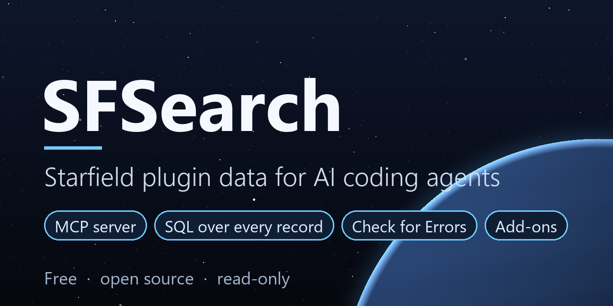

SFSearch reads Starfield plugins (`.esm`, `.esp`) and answers questions about them. It's built for AI coding agents working on Starfield mods: Claude Code, Codex, Cursor and the like. You can run it by hand too.

Think of it as SF1Edit's data, ready for an agent to search. Instead of writing its own plugin parser and getting things subtly wrong, an agent asks SFSearch:

- What is this FormID, in every plugin that has it? What is it called in game?
- Which version of this record wins in my load order, and what does each plugin change?
- What points at this record?
- What does this mod change in its masters? Are any of its overrides ITMs?
- How does my patch differ from another patch for the same mod?
- What changed since a mod updated, and which patches did that break?
- What do this mod's Papyrus scripts do?
- Is this plugin built right? (like SF1Edit's Check for Errors)
- What's inside this mod's archives, and are the textures behind its materials all there?
- What can this leveled list give, and what do this quest's characters say?
- Anything else, in SQL, across any plugin or the whole load order.

**It only reads.** SFSearch never changes anything in your Data folder. **Starfield only.**

**It reads the plugins live, every time.** SFSearch keeps no database of your records, so an answer can't be out of date, and there is nothing to rebuild after a game or mod update.

## Try it in 5 minutes
You need Windows, Starfield, Claude Code (or another agent that speaks MCP), and the .NET 10 SDK (`winget install Microsoft.DotNet.SDK.10`).

```powershell
git clone https://github.com/Krawphish37/SFSearch.git C:\Modding\SFSearch
C:\Modding\SFSearch\SFSearch\sfs.cmd Version
dotnet build C:\Modding\SFSearch\SFSearch.Mcp -c Release
claude mcp add sfsearch --scope user -- "C:\Modding\SFSearch\SFSearch.Mcp\bin\Release\net10.0\SFSearch.Mcp.exe" --home "C:\Modding\SFSearch\SFSearch"
```

Start a new Claude Code session, approve the `sfsearch` server, and ask:

> Use SFSearch: which of my mods change the Eon pistol, and which version wins in my load order?

The first call starts SFSearch's service, which is ready for questions in about 2 seconds. The sections below explain each step, other agents, and the settings.

## How agents use it
- **The MCP server (`SFSearch.Mcp`) is the main way in.** It gives an agent 12 tools with plain arguments: no shell quoting, and SQL can span lines.

  | Tool | Answers |
  |---|---|
  | `sfs_find` | What a FormID, EditorID or in-game name is; records by pattern or type; who holds each and who wins |
  | `sfs_record` | One record: its fields, its JSON, the file's bytes, every plugin's version, proof of a value |
  | `sfs_describe` | What a record type's fields are called, with xEdit's name beside each |
  | `sfs_query` | SQL over one plugin, several, or what the game uses from the whole load order |
  | `sfs_refs` | What points at a record, and what it points at |
  | `sfs_compare` | A record across the load order; two records; a plugin against its masters; two versions of a mod; a patch against a reference patch |
  | `sfs_loadorder` | The load order, one plugin, the problems found, what changed since last time |
  | `sfs_check` | Is a plugin built right: 19 checks, ITMs, missing assets and textures, a read-and-write round trip |
  | `sfs_saved` | 27 ready-made queries (recipes, keywords, attach points, leveled lists, …), and your own |
  | `sfs_run` | The reports (leveled lists, dialogue, where items come from, archives, scripts) and add-ons |
  | `sfs_job`, `sfs_status` | Collect a long answer; the service's health |

- **Every answer has the same parts:** the answer, `[more]` with a cursor when it was cut, `[notes]` with warnings, `[source]` (which copy of which plugins it was read from) and `[cost]`. An error is one line that says what to do. This is a real answer:
  ```text
  > sfs_record {"record": "kgcDoom_WEAP_SuperShotgun", "view": "fields", "fields": "AttackDamage,HasScope,Keywords[7],Name"}
  kgcDoom_WEAP_SuperShotgun (007751:kgcdoom.esm)
  WEAP Weapon in kgcdoom.esm (its own record), at 0xD313, 2,403 bytes
  Read from kgcdoom.esm: the plugin that wins it (the last loaded of the 2 that hold it). Held by (winner first): kgcdoom.esm > darkstarpatch_athellsgate.esm (not loaded).
    AttackDamage = 80.0
    HasScope = false   [the default: the record's JSON leaves it out, and the schema says the field is always there]
    Keywords[7] = kgcDoom_Tag_WeaponTypeDoom (0076BE:kgcdoom.esm)
    Name = Super Shotgun
  [source] kgcdoom.esm 3.5 MB, key 9561e0c8; load order (224 loaded, plugins.txt) 9 KB, key b730711a
  [cost] 33 ms; read 1 WEAP of kgcdoom.esm
  ```
- **Heavy work asks first.** Anything estimated over 10 seconds or 2 GB of memory answers with its cost and runs only when the agent asks again with `allow_heavy`. A job that needs more memory than Windows has available is refused at once; it never makes the PC page.
- **The tools talk to the SFSearch service,** which starts by itself on the first call. It serves many agents at once: several worker programs run commands side by side, a crashed worker is replaced and its command run again, and nothing hangs.
- **The command line works too:** `SFSearch\sfs.cmd <verb> ...`, with the same verbs and arguments as the tools (`find`, `record`, `describe`, `query2`, `refs2`, `compare`, `loadorder2`, `check2`, `saved`, and the reports). `sfs.cmd <verb> --help` shows a verb's options.

## What you need
- **Windows 10 or 11.**
- **Starfield.** Steam and Xbox (Game Pass) installs are found by themselves; only Steam has been tested. Any other location works with `sfs.cmd SetData "<path to Data>"`.
- **The .NET 10 SDK** (SFSearch builds itself the first time you run it):
  ```powershell
  winget install Microsoft.DotNet.SDK.10
  ```
- **About 1 to 2 GB of disk space** for working files while the service runs. They are deleted at every service start.
- **For the `scripts2` report only:** [Champollion](https://github.com/Orvid/Champollion/releases) 1.3.2 or newer. Put `Champollion.exe` in `SFSearch\tools\champollion\`, or set its path in `sfsearch.json`.

## Install
1. Get the repository into a folder of its own (avoid `Program Files`):
   ```powershell
   git clone https://github.com/Krawphish37/SFSearch.git C:\Modding\SFSearch
   ```
2. Build and try it. The first run builds SFSearch:
   ```powershell
   C:\Modding\SFSearch\SFSearch\sfs.cmd Version
   C:\Modding\SFSearch\SFSearch\sfs.cmd find "000CF2" --in Starfield.esm
   ```
   The second line prints the record with that FormID:
   ```text
   | Record | Type | Name | Inside | Held by (winner first) |
   | :--- | :--- | :--- | :--- | :--- |
   | [no EditorID] (000CF2:Starfield.esm) | REFR PlacedObject |  | CELL LC008SlaytonAerospace (06A716:Starfield.esm) | Starfield.esm |
   ```
   If Starfield isn't found by itself, tell SFSearch once: `sfs.cmd SetData "D:\Games\Starfield\Data"`.
3. Build the MCP server:
   ```powershell
   dotnet build C:\Modding\SFSearch\SFSearch.Mcp -c Release
   ```

## Connect your agent
**Claude Code**, for every project:
```powershell
claude mcp add sfsearch --scope user -- "C:\Modding\SFSearch\SFSearch.Mcp\bin\Release\net10.0\SFSearch.Mcp.exe" --home "C:\Modding\SFSearch\SFSearch"
```
Or for one project, put this in a `.mcp.json` file in that project's folder:
```json
{
  "mcpServers": {
    "sfsearch": {
      "type": "stdio",
      "command": "C:\\Modding\\SFSearch\\SFSearch.Mcp\\bin\\Release\\net10.0\\SFSearch.Mcp.exe",
      "args": ["--home", "C:\\Modding\\SFSearch\\SFSearch"]
    }
  }
}
```
Start a new session and approve the `sfsearch` server when asked. Ask something like "what is 000CF2 in Starfield.esm?" to check it works.

**Other agents** that speak MCP: the same program and arguments. Agents without MCP can run `sfs.cmd` directly.

**Give your agent the guide:** `AGENTS.md`, and `agent-docs/skills/sfsearch/SKILL.md` (which tool answers which question, and how to read an answer). For Claude Code, copy the `agent-docs/skills/sfsearch` folder into your project's `.claude/skills/` folder.

**Coming from SFSearch 1.x:** the 25 older tools and the older commands (`Query`, `Names`, `Refs`, `Check`, `Inspect`, `LoadOrder` and the rest) were removed in 2.0. An old command's name now answers with one line that names the verb to use (`Error: Names was one of SFSearch's older commands, removed in 2.0. Fix: use find <FormID or EditorID> (sfs_find) ...`), and an MCP configuration that still passes `--legacy-tools` starts the server with the 12 tools. `agent-docs/skills/sfsearch/references/old-tools.md` maps every old command and tool to its new call. Add-ons built for 1.x need a rebuild (`sfs.cmd` does it by itself when it finds their source).

## One way to run: the service
The service is started by the MCP tools, or by hand:
```powershell
sfs.cmd Service start      # also: stop | restart | status | config
```
While it runs, every `sfs.cmd` command goes to it. With no service, a command still works: it reads what it needs by itself and is slower, because nothing is held open between commands.

**What the first question costs.** Nothing is prepared ahead and kept, so the service works from the plugin files each time it starts. Measured on a Data folder of 370 plugins (3.96 GB, 12.2 million records):

| Step | Time |
|---|---|
| The service's index of every record (FormKey, type, EditorID, who holds it): ready for questions | about 2 s |
| Its index of links and in-game names, built in the background after that | about 15 s (9.5 s on the last run) |
| The first question about a record type reads that type: Starfield.esm's 406 weapons, its 7,131 NPCs | 0.03 s, 0.2 s |
| The same type asked again | found ready |
| The slowest ordinary type of Starfield.esm (126,347 dialogue lines) | 1.3 to 1.7 s |
| Every placed object of Starfield.esm (3,291,860), one field. Heavy: asks first | about 4 s |
| A typical answer once things are read | 0.03 to 0.15 s |

Until the link index is ready, tools still answer; they say what isn't there yet (in-game names for some plugins), and "what points at this" searches the files' bytes instead.

## What is on disk
Everything is in the `SFSearch` folder (the "home").

| Folder or file | What it is |
|---|---|
| `scratch\` | Working files: the two indexes and the tables SQL reads. **Emptied at every service start.** Safe to delete when the service isn't running. For 370 plugins the indexes are 0.8 GB; the tables grow with what is asked (all ordinary record types of Starfield.esm: 1.1 GB). A `scratch\legacy` folder left by a 2.0 preview build goes with the next service start |
| `kept\` | Two small things that outlive a service start: decompiled Papyrus scripts (`kept\scripts\`), and the log of what changed in your Data folder (`kept\history\`). Safe to delete: scripts are decompiled again, and the history starts again. `Scripts.db` and `History.db`, which 2.0 preview builds kept here, aren't read any more: delete them when you like |
| `state\` | Three small files: your Data folder's path if you set one with `SetData`, the running service's marker, and which one-time notes were shown |
| `sfsearch.json` | Your settings |
| `queries\` | Stored queries you saved |
| `extensions\` | Add-ons |
| `Service\` | The service's log (`logs\`) and long answers the MCP server saved to files (`results\`, deleted after a week). A `usage.txt` left by an earlier version isn't read any more |
| `Cache\`, `Service\data\` | **Databases of SFSearch 1.x. They aren't read or written any more, and SFSearch never deletes them: delete both folders yourself** (they can be many GB). Run one command with this version first: it copies the one small thing it still needs out of `Cache\` (your Data folder's path, to `state\`) and says once how much the two folders hold. `sfs.cmd Service status` shows that line until they are gone |

## Updating
```powershell
cd C:\Modding\SFSearch
git pull
dotnet build SFSearch.Mcp -c Release
```
Then start a new agent session (the MCP server is loaded when a session starts). SFSearch itself rebuilds on its next command; if the service is running, `sfs.cmd Service restart` puts it on the new version. Your settings, stored queries and add-ons aren't touched, and there is nothing to rebuild: the service starts from the plugin files. `sfs.cmd Version` shows the version you have.

If `dotnet build` says the MCP server's `.exe` is in use, close your agent sessions first.

## Settings: `SFSearch\sfsearch.json`
SFSearch writes this file, with every line explained, the first time the service starts (or when you run `sfs.cmd Service config`). It's yours: updates never change it. Edit and save: the service reads it again by itself. `sfs.cmd Service config` shows what's in effect. To go back to the defaults, delete it.
- **Workers and time:** `workers` (commands at once), `jobTimeoutMinutes` (10), `queueLimit` (500).
- **Memory:** left at 0, the memory settings are worked out from your PC when the service starts, so SFSearch fits an 8 GB laptop and a 64 GB PC alike; a number you put in is kept. `sfs.cmd Service config` shows each number in effect and where it came from. A file written by an older version is rewritten once: the numbers that version put there by itself (`"workers": 8`, `"workerMaxMB": 12288` or `6144`, `"workerRecycleMB": 3072`) become 0, so they come from the PC; every other line stays, and the file as it was is kept as `sfsearch.json.before-v2.bak`. A number you put in later is kept.
    - `serviceMaxMB`: what the workers together may hold. Above it no new command starts. 0 means half of the PC's memory.
    - `workers`: 0 means one per 2 GB of `serviceMaxMB`, at least 2, at most 8 and at most the cores less 2 (8 on a 32 GB PC or bigger).
    - `workerMaxMB` and `workerRecycleMB`: one command is stopped above the first; a worker is replaced after a command that left it above the second. 0 means a third of `serviceMaxMB` (1.5 to 6 GB: 2.7 GB on a 16 GB PC, 6 GB on a 64 GB PC), and half of that (1 to 3 GB).
    - `memoryFloorMB` (new): while commands run and Windows has less than this available, the indexer gives way, then the biggest command is stopped with one line (`Error: the PC was short of memory …`, exit code 8) and can be asked again. 0 means the larger of 1.5 GB and 5% of the PC's memory.
    - `heavyMinMB` (new, 2048): a command that estimates itself at this much or more is heavy. One heavy command runs at a time.
    - `heavySpareMB` (new, 4096): a heavy command starts only when Windows has its estimate plus this much available. If not, it fails at once with one line.
    - `heavyJobTimeoutMinutes` (new, 30): a heavy command's own time limit.
- **No longer used:** `warmup` and `dataCapGB` were for the older commands' tables, removed in 2.0. A file that still has them works as before; they change nothing, and `sfs.cmd Service config` says so. Delete them when you like.
- **Another load order:** `pluginsTxt` reads the load order from another `plugins.txt`, e.g. a second Windows account's. Empty means Starfield's own.
- **Champollion:** `champollion` is the path to `Champollion.exe` for the `scripts2` report.

An environment variable of the same setting (`SFSEARCH_WORKERS`, `SFSEARCH_HISTORY=0`, …) overrides the file.

## Your own commands (add-ons)
SFSearch knows Starfield's records, not any one mod. Knowledge about a mod goes in an **add-on**:
- a check for patches built against a framework mod
- a lookup that explains a crafting overhaul's tiers
- a report a mod's authors want every patcher to run

Add-ons can be made by anyone and shared.

**Using one:** put its `.dll` in `SFSearch\extensions\`. Its commands then work like SFSearch's own: on the command line, through the service, and over MCP with `sfs_run`. `sfs.cmd Extensions` lists what's installed, and `Service status` names them too. An add-on `X.dll` can bring stored queries with it, in a folder `X.queries\` beside it; they show in `sfs_saved` as `X.<name>`.

**Making one:**
1. Copy `extensions\SFSearch.Example` and rename the folder and project to `SFSearch.<ModFamily>`, e.g. `SFSearch.MyMod`. The part after `SFSearch.` is the add-on's name.
2. Write your commands in the class that implements `ISfsExtension`: each command's name and its help line, and a `Run` method. Use the add-on API (`SFSearch\AddOnApi.cs`, namespace `SFSearch.AddOns`): `GameData` finds plugins and records, runs SQL and comparisons, `PluginView` reads a plugin's records live through Mutagen, `Args` takes options, `Out` prints. The example's `KeywordCount` opens a plugin, finds a keyword by EditorID or FormKey, walks the plugin's records and prints a table. `DEVELOPING.md` lists the whole API.
3. `dotnet build -c Release` in its folder. The build puts the `.dll` in `SFSearch\extensions\` (or where `-p:SfsExtensionsDir=<folder>` says). From then on, `sfs.cmd` rebuilds it by itself when its code or SFSearch changes. A `.dll` can be replaced while the service runs.

**For a question that is only SQL, write a stored query,** not an add-on: a `.sql` file with a short header, no code (`queries\README.md`).

**Names:** keep command names short (`Lint`, `TierDiff`). If two add-ons have a command with the same name, SFSearch asks for the full name, `<AddOn>.<Command>` (`MyMod.Lint`), instead of guessing. SFSearch's own commands always come first, and so do the names of its removed older commands (`Query`, `Check`, ...), which answer with the verb to use.

**Versions:** an add-on is built against one SFSearch. When SFSearch's first version number changes (its add-on API changed), older add-ons aren't loaded and SFSearch says to rebuild them.

**Sharing, and safety:** an add-on is a program. It runs with your rights, like any mod tool or script extender plugin. Share add-ons as source code that people build themselves, and only install `.dll` files from people you trust. SFSearch's own commands only read your Data folder; an add-on is expected to as well.

## About the Mutagen build
SFSearch reads plugins with [Mutagen](https://github.com/Mutagen-Modding/Mutagen). It needs fixes that aren't in a published Mutagen version yet: real data that used to be lost, crashes on some plugins, text that kept changing on save. That build (`0.55.0-fixes.17`, with Mutagen.Bethesda.Serialization `1.38.6-fixes.3`) is in `packages/`.

Its full source is public, as GPL-3.0 asks: the `fixes17` branch of [Krawphish37/Mutagen](https://github.com/Krawphish37/Mutagen/branches) and the `fixes17` branch of [Krawphish37/Mutagen.Bethesda.Serialization](https://github.com/Krawphish37/Mutagen.Bethesda.Serialization/branches). Each package names the commit it was built from. To get them:
```powershell
git clone -b fixes17 https://github.com/Krawphish37/Mutagen
git clone -b fixes17 https://github.com/Krawphish37/Mutagen.Bethesda.Serialization
```
(GitHub often times out showing pages of the Mutagen repository, which is very large; cloning always works.) SFSearch 1.0.x used `0.55.0-fixes.5`, from the `starfield-fixes5` branch.

## Status
Version `2.0.0`, with the older commands and tools removed. Tested on one PC (Steam install, 370 plugins, 224 loaded). The numbers below were taken before the removal:
- **455 real past commands** recorded from agent sessions: 452 run (3 name files that no longer exist), and all 452 answer line for line as before the new tools were added. Since the removal each of them is held to the call that answers it now, and each old command's name to its pointer line (`sfsharness mapping`).
- **The 16 traps of the 1.x agent guide** (wrong answers with no error): each now can't happen, or gives a clear error or warning. All 16 have a tested case, and all pass.
- **The MCP server's own test** (with the author's calls of every tool): 98 calls of the 12 tools, 102 of 102 checks pass. The 12 tool definitions are 8,796 characters (the 25 older ones, removed in 2.0, were 14,789).
- **69 SQL questions** (32 in the repository's tests, 37 from the agent benchmark), each held against Mutagen's own answer: 69 of 69 equal.
- **Round trips** (read a plugin, write it through Mutagen, compare byte for byte): identical for weap_starlight.esm, kgcdoom.esm, darkstar.esm, BlueprintShips-Starfield.esm (303,656,303 bytes) and Starfield.esm (1,457,098,709 bytes, 3,829,246 records).
- **A soak test:** 240 seconds, 16 clients, old and new tools mixed, workers killed on purpose: 10,136 commands with no wrong answer and no hang. One earlier run of four had 2 wrong answers among 10,704, both from the older `Live` command sent through the older tools (removed in 2.0).
- **60 agent benchmark questions** from past sessions (a dev tool the author keeps out of the repository, so that the agents it measures can't have seen its answers): the tools' own answers hold the known answer for 59. The 60th is the ITM count of darkstar.esm, where the new check is right (21) and the old known answer wasn't (20).

- **A blind run:** a fresh agent with only the MCP tools and their descriptions (no guide, no answers) got 91 of 92 questions right (the 60 benchmark questions and 32 SQL questions).

Not tested yet: Game Pass installs; other PCs. Found a problem? Open an issue with the output of `sfs.cmd Version` and the command you ran.

## License
GPL-3.0, because Mutagen and the libraries around it are. See `LICENSE` and `THIRD_PARTY_NOTICES.md`.
