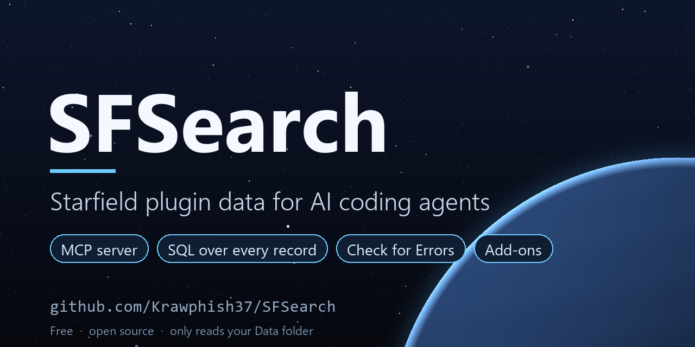

SFSearch reads Starfield plugins (`.esm`, `.esp`) and answers questions about them. It's built for AI coding agents working on Starfield mods: Claude Code, Codex, Cursor and the like. You can run it by hand too.

Think of it as SF1Edit's data, ready for an agent to search. Instead of writing its own plugin parser and getting things subtly wrong, an agent asks SFSearch:

- What is this FormID, in every plugin that has it?
- Which version of this record wins in my load order, and what does each plugin change?
- What points at this record?
- What does this mod change in its masters? Are any of its overrides ITMs?
- What changed since a mod updated, and which patches did that break?
- What do this mod's Papyrus scripts do?
- Is this plugin built right? (like SF1Edit's Check for Errors)
- What's inside this mod's archives, and are the textures behind its materials all there?
- What can this leveled list give, and what do this quest's characters say?
- Anything else, in SQL, across any plugin or the whole load order.

**It only reads.** SFSearch never changes anything in your Data folder. **Starfield only.**

## Try it in 5 minutes
You need Windows, Starfield, Claude Code (or another agent that speaks MCP), and the .NET 10 SDK (`winget install Microsoft.DotNet.SDK.10`).

```powershell
git clone https://github.com/Krawphish37/SFSearch.git C:\Modding\SFSearch
C:\Modding\SFSearch\SFSearch\sfs.cmd Version
dotnet build C:\Modding\SFSearch\SFSearch.Mcp -c Release
claude mcp add sfsearch --scope user -- "C:\Modding\SFSearch\SFSearch.Mcp\bin\Release\net10.0\SFSearch.Mcp.exe" --home "C:\Modding\SFSearch\SFSearch"
```

Start a new Claude Code session, approve the `sfsearch` server, and ask:

> Use SFSearch: which of my mods change the Eon pistol, and which version wins in my load order?

The first question about Starfield.esm takes up to a minute while SFSearch reads it; after that, answers come back in a second or two. The sections below explain each step, other agents, and the settings.

## How agents use it
- **The MCP server (`SFSearch.Mcp`) is the main way in.** It gives an agent tools such as `sfs_query`, `sfs_names`, `sfs_record`, `sfs_conflicts`, `sfs_loadorder` and `sfs_fields`, with plain arguments: no shell quoting, SQL can span lines.
- **The tools talk to the SFSearch service,** which starts by itself on the first call. It serves many agents at once: several worker programs run commands side by side, a crashed worker is replaced and its command run again, and nothing hangs. It reads each plugin's record types the first time they're needed and keeps them. While nobody is asking anything, it reads ahead (the warm-up).
- **The command line still works:** `SFSearch\sfs.cmd <Command> ...`. While the service runs, commands go to it.

## What you need
- **Windows 10 or 11.**
- **Starfield.** Steam and Xbox (Game Pass) installs are found by themselves; only Steam has been tested. Any other location works with `sfs.cmd SetData "<path to Data>"`.
- **The .NET 10 SDK** (SFSearch builds itself the first time you run it):
  ```powershell
  winget install Microsoft.DotNet.SDK.10
  ```
- **Disk space** for the databases: usually a few MB per mod, up to about 2 GB for Starfield.esm, more with a big load order. Their size cap is a setting.
- **For the `Scripts` command only:** [Champollion](https://github.com/Orvid/Champollion/releases) 1.3.2 or newer. Put `Champollion.exe` in `SFSearch\tools\champollion\`, or set its path in `sfsearch.json`.

## Install
1. Get the repository into a folder of its own (avoid `Program Files`):
   ```powershell
   git clone https://github.com/Krawphish37/SFSearch.git C:\Modding\SFSearch
   ```
2. Build and try it. The first run builds SFSearch (about a minute):
   ```powershell
   C:\Modding\SFSearch\SFSearch\sfs.cmd Version
   C:\Modding\SFSearch\SFSearch\sfs.cmd Names "000CF2" --in Starfield.esm
   ```
   If Starfield isn't found by itself, tell SFSearch once: `sfs.cmd SetData "D:\Games\Starfield\Data"`.
3. Build the MCP server:
   ```powershell
   dotnet build C:\Modding\SFSearch\SFSearch.Mcp -c Release
   ```

## Connect your agent
**Claude Code**, for every project:
```powershell
claude mcp add sfsearch --scope user -- "C:\Modding\SFSearch\SFSearch.Mcp\bin\Release\net10.0\SFSearch.Mcp.exe" --home "C:\Modding\SFSearch\SFSearch"
```
Or for one project, put this in a `.mcp.json` file in that project's folder:
```json
{
  "mcpServers": {
    "sfsearch": {
      "type": "stdio",
      "command": "C:\\Modding\\SFSearch\\SFSearch.Mcp\\bin\\Release\\net10.0\\SFSearch.Mcp.exe",
      "args": ["--home", "C:\\Modding\\SFSearch\\SFSearch"]
    }
  }
}
```
Start a new session and approve the `sfsearch` server when asked. Ask something like "what is 000CF2 in Starfield.esm?" to check it works.

**Other agents** that speak MCP: the same program and arguments. Agents without MCP can run `sfs.cmd` directly.

**Give your agent the guide:** `AGENTS.md`, and `agent-docs/skills/sfsearch/SKILL.md` (which tool answers which question, and the traps that give wrong answers with no error). For Claude Code, copy the `agent-docs/skills/sfsearch` folder into your project's `.claude/skills/` folder.

## Updating
```powershell
cd C:\Modding\SFSearch
git pull
dotnet build SFSearch.Mcp -c Release
```
Then start a new agent session (the MCP server is loaded when a session starts). SFSearch itself rebuilds on its next command; if the service is running, `sfs.cmd Service restart` puts it on the new version. Your settings, databases and add-ons aren't touched. `sfs.cmd Version` shows the version you have.

If `dotnet build` says the MCP server's `.exe` is in use, close your agent sessions first.

## Settings: `SFSearch\sfsearch.json`
SFSearch writes this file, with every line explained, the first time it runs. It's yours: updates never change it. Edit and save: the service reads it again by itself. `sfs.cmd Service config` shows what's in effect. To go back to the defaults, delete it.
- **Warm-up:** on or off, and what to read ahead. Examples:
    - only Starfield.esm: `["Starfield.esm"]`
    - the base game and the DLCs: `["Starfield.esm", "ShatteredSpace.esm", "SFBGS050.esm"]`
    - every Bethesda file, then the plugins you worked on lately: `["@official", "@recent"]`

  After a game or mod update, it reads the changed files again.
- **Item filter:** how SFSearch sorts weapons (pistol, rifle, and so on) and armor (spacesuit, helmet, and so on), and what counts as junk. Change the lists to suit your mods; databases built with other rules are rebuilt by themselves.
- **The service's limits:** workers, time limit, memory, queue, and the size cap for its databases.

## Other ways to run it
| Way | How | What it keeps |
|---|---|---|
| The service | Started by the MCP tools, or `sfs.cmd Service start` | Its databases in `SFSearch\Service\data`, kept between restarts |
| Stored databases | `sfs.cmd` commands while the service isn't running | A full database per plugin in `SFSearch\Cache` |
| `--live` | Add `--live` to a command while the service isn't running | Nothing: builds what that command needs, then deletes it |

`sfs.cmd Service status | stop | restart` control the service. `sfs.cmd --help` lists every command.

## Your own commands (add-ons)
SFSearch knows Starfield's records, not any one mod. Knowledge about a mod goes in an **add-on**:
- a check for patches built against a framework mod
- a lookup that explains a crafting overhaul's tiers
- a report a mod's authors want every patcher to run

Add-ons can be made by anyone and shared.

**Using one:** put its `.dll` in `SFSearch\extensions\`. Its commands then work like SFSearch's own: on the command line, through the service, and over MCP with `sfs_run`. `sfs.cmd Extensions` lists what's installed, and `Service status` names them too.

**Making one:**
1. Copy `extensions\SFSearch.Example` and rename the folder and project to `SFSearch.<ModFamily>`, e.g. `SFSearch.DarkStar`. The part after `SFSearch.` is the add-on's name.
2. Write your commands in the class that implements `ISfsExtension`: each command's name and its help line, and a `Run` method. The example's `KeywordCount` shows how to open a plugin's database, find a record and print a table with SFSearch's helpers. The tables are described in `agent-docs\skills\sfsearch\references\database.md`.
3. `dotnet build -c Release` in its folder. The build puts the `.dll` in `SFSearch\extensions\`. From then on, `sfs.cmd` rebuilds it by itself when its code or SFSearch changes. A `.dll` can be replaced while the service runs.

**Names:** keep command names short (`Lint`, `TierDiff`). If two add-ons have a command with the same name, SFSearch asks for the full name, `<AddOn>.<Command>` (`DarkStar.Lint`), instead of guessing. SFSearch's own commands always come first.

**Versions:** an add-on is built against one SFSearch. When SFSearch's first version number changes (its add-on API changed), older add-ons aren't loaded and SFSearch says to rebuild them.

**Sharing, and safety:** an add-on is a program. It runs with your rights, like any mod tool or script extender plugin. Share add-ons as source code that people build themselves, and only install `.dll` files from people you trust. SFSearch's own commands only read your Data folder; an add-on is expected to as well.

## About the Mutagen build
SFSearch reads plugins with [Mutagen](https://github.com/Mutagen-Modding/Mutagen). It needs fixes that aren't in a published Mutagen version yet: real data that used to be lost, crashes on some plugins, text that kept changing on save. That build (`0.55.0-fixes.5`) is in `packages/`. Its full source is public: the `starfield-fixes5` branch of [Krawphish37/Mutagen](https://github.com/Krawphish37/Mutagen/branches). To get it:
```powershell
git clone -b starfield-fixes5 https://github.com/Krawphish37/Mutagen
```
(GitHub often times out showing pages of the Mutagen repository, which is very large; cloning always works.)

## Status
Version 1.0.0. Tested on one PC (Steam install, about 370 plugins):
- about 150,000 commands from 32 clients at once, with workers and the service killed on purpose, and no wrong answers
- 455 real past questions give the same answers through MCP as from stored databases
- `Check`, `Archive`, `Materials`, `Leveled` and `Dialogue` tried on a dozen mods and the base game; their first runs found real problems (a patch broken by a mod update, materials pointing at textures that don't exist)

Not tested yet: Game Pass installs, other PCs. Found a problem? Open an issue with the output of `sfs.cmd Version` and the command you ran.

## License
GPL-3.0, because Mutagen and the libraries around it are. See `LICENSE` and `THIRD_PARTY_NOTICES.md`.
